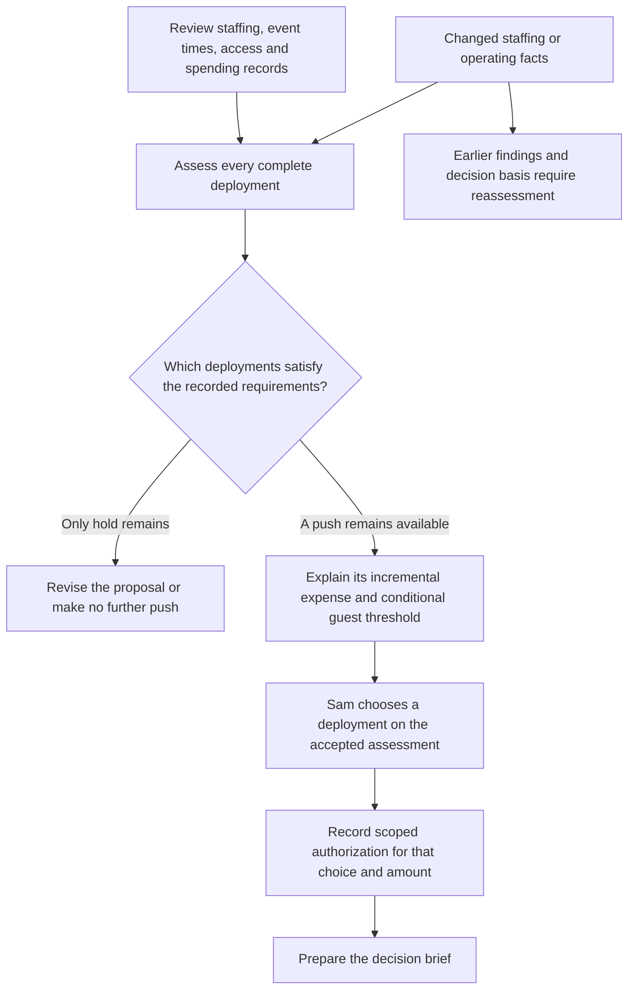

# Build a complete promotion workflow with the CLI

Sam has seven qualified people scheduled at a fictional venue. Four must stay
inside. He can hold, send one promoter for $200, send two for $400, or send two
with a discounted offer. Two callouts arrive before dispatch. Which complete
deployments still satisfy the operating requirements, and what would Sam be
committing to?

This walkthrough authors the app and workflow, rather than beginning with
unexplained prebuilt rules. All sources are in the portable
[street-team example](../../examples/street-team-deployment/README.md). Its
operating app reuses `complete-a-commitment/1`. The existing guided Decision Lab
interface can install its package and continue its CLI-created case.

## Keep the three decisions separate



The operating app establishes eligibility. Conditional arithmetic explains how
many **genuinely additional guests** would cover a stated expense. Sam supplies
the choice and specific authorization. Neither the threshold nor accepting a
calculation predicts customers, justifies a profit-maximizing choice or dispatches
staff.

## Use the qualified development build

Use Node **22.19+**; Node 24 is recommended. Install the SDK and CLI together
using the matching supplied development archives. The example's
[exact build receipt](../../examples/street-team-deployment/qualified-build.json)
records their versions and SHA-256 hashes. Older archives also labeled `0.1.0`
can lack the two arithmetic operators or feasibility-only mode. This guide does
not announce registry publication.

From the documentation repository root:

```sh
npm install /path/to/decision-lab-sdk-0.1.0.tgz /path/to/decision-lab-cli-0.1.0.tgz
node examples/street-team-deployment/walkthrough.mjs all \
  --output-root .output/promotion \
  --accept-fictional-demo
```

Read the authored reviews and fictional case first. The explicit flag permits
the runner to record those named teaching reviews; it is not a general approval
mechanism. To inspect each transition, replace `all` with the stages below,
using the same output root in order. Use a new output root to repeat a run.

| Stage | What the CLI produces | What a person reviews |
| --- | --- | --- |
| `author` | Template, app, app scenarios, workflow draft, binding reviews, workflow scenarios and installable package | Rules, assumptions, mappings, units and independently expected results |
| `intake` | Reviewed initial answers and accepted operating finding | Seven qualified staff, four required inside, complete charges, time and permission records |
| `callouts` | Changed staffing, stale old finding, reassessed and reviewed alternatives | Five available staff: one promoter leaves four inside; two leave three |
| `decision` | Sam's proposal, separate scoped authorization and completed brief | One-person $200 push on this exact accepted assessment |
| `changed-staffing` | A third callout, renewed assessment and retained history | Only hold remains; the old choice and authorization no longer complete this review |
| `verify` | Checks of native runs, complete reports and expected outcomes | Package identity, threshold results, choice scope and reassessment behavior |

## 1. Define the operating app

The [canonical model](../../examples/street-team-deployment/source/promotion.model.json)
contains the published rules and a separate starting case. The module author
fixes four deployment structures, the requirement meanings, scoped permission
checks and the simplified staffing assumptions. Its canonical starting case
supplies counts, records, quoted expense and same-day times. This first workflow
pins option charges to those app defaults; workers edit staffing, timing, access,
spending limits/delegation and economic assumptions. New quotes require a new
authored app/workflow release until quotes have their own reviewed workflow
question. Rules do not appear in the runner.

The template and app are created through ordinary public commands:

```sh
decision-lab template init --pattern complete-a-commitment/1 \
  --id bounded-promotion --version 1.0.0 --title "Review a bounded promotion" \
  --require-module-field assumptions --output promotion.template.yaml
decision-lab template validate promotion.template.yaml
decision-lab template pack promotion.template.yaml --output promotion.template.json
decision-lab app init --template promotion.template.json \
  --model examples/street-team-deployment/source/promotion.model.json \
  --app-id street-team-operating-review --release 1 --output promotion.app.yaml
decision-lab app validate promotion.app.yaml
decision-lab app pack promotion.app.yaml --output promotion.app.json
decision-lab app check --app promotion.app.json \
  --suite examples/street-team-deployment/source/app.scenarios.json \
  --output promotion.app-checks.json
```

These commands illustrate the public authoring sequence. The runner also supplies
fixed teaching timestamps and a description, so its exact package hashes come
from its saved `author/commands.sh`, not from this shortened excerpt.

The module declares:

```json
{ "preference": { "mode": "feasibility-only" } }
```

The resulting assessment retains every feasible assignment and gives no
automatic recommendation. “Hold” is an available baseline, not the best
promotion merely because its incremental cash cost is zero.

The bounded staffing model assumes every counted person can perform the
simplified inside work and remains available for the whole absence. Time is
limited to one calendar day. It does not model stations, breaks, overnight
shifts or adaptive deployment policies. Extend the module deliberately if those
facts matter; changing a case cannot silently add new operating rules.

## 2. Define the guided workflow

The [workflow source](../../examples/street-team-deployment/source/workflow.source.json)
declares eight question groups: staffing, timing, access, spending, contribution,
separate discount loss, proposal and authorization. Each has a business meaning,
responsible role, shared-case path and presentation definition.

Only the four operating answers are required by the app evaluation. Unknown
contribution leaves the financial explanation unassessed without blocking a
staffing and timing review. The workflow binds those operating answers to the
app's native case and returns its complete option findings and actual expenses.

The runner embeds the app package it just created into the source dependency
before calling `workflow create`. This is plain file assembly: it does not
reimplement a constraint. The resulting definition pins the exact app content
hash. After creating a draft, inspect it:

```sh
decision-lab workflow inspect-draft --draft .output/promotion/author/workflow.draft.json
```

The author must review the individual entries in
[binding-reviews.json](../../examples/street-team-deployment/source/binding-reviews.json).
They explain meaning, scope and units for each binding. The runner compares
their exact IDs and reviewed declaration hashes with the current inspection.
If either differs it stops before applying any fixture review. It never copies
an arbitrary binding's generated text back as an automatic approval. A changed
meaning, rule or mapping requires a new deliberate review, even when its ID is
unchanged.

Every review uses `workflow review-binding`; the exact commands and checkpoints
are saved. Before those reviews, `workflow pack` is expected to fail with exit
2 and write no package. The runner then checks
[workflow scenarios](../../examples/street-team-deployment/source/workflow.scenarios.json)
and attaches the exact results to the reviewed draft before packaging. These
scenario reviews are explicitly synthetic test fixtures, separate from Sam's
worked-case reviews.

## 3. Explain the commitment without predicting guests

The workflow brief contains the financial rule once. It takes the native
operating plan's assessed expense, adds any separately recorded loss on customers
who would have visited anyway, and uses integer USD cents:

```text
cover expense:         ceilDivide(expense + separate loss, contribution)
first positive count: floorDivide(expense + separate loss, contribution) + 1
```

| Conditional assumption | Cover expense | First positive count |
| --- | ---: | ---: |
| $200 expense, $40 per additional guest | 5 | 6 |
| $400 expense, $40 per additional guest | 10 | 11 |
| $400 expense, $25 per additional guest | 16 | 17 |
| $400 expense plus $50 separate loss, $40 per additional guest | 12 | 12 |

Contribution means retained contribution after the offer and variable costs.
Do not include sunk costs or subtract a discount again if it is already in that
contribution. Unknown amounts stay unassessed; nonpositive contribution cannot
cover a positive expense. Hold has no promotion threshold. The shared
[whole-unit operators](run-a-workflow.md#calculate-whole-unit-thresholds) reject unsafe or
invalid operands rather than returning a misleading number.

## 4. Work the case and record Sam's decision

The [initial case](../../examples/street-team-deployment/source/cases/initial.json)
is distinct from the published model and workflow. `workflow start` seeds its
values awaiting review. The runner uses `workflow answer` for each supplied
answer, then `workflow prepare`, `workflow evaluate` and `workflow review` for
the exact operating evaluation. A complete calculation does not accept itself.

Two callouts update the staffing answer. The earlier finding becomes stale.
The accepted reassessment leaves Hold and the one-person push available.
Sam chooses the one-person push; the proposal stores the exact accepted app-run
hash and evaluation reference. His separate authorization repeats that basis,
deployment, venue and operating date, and records its $200 cap and validity
window. Before authorization, the brief remains incomplete.

The third-callout branch preserves that historical proposal and authorization
but makes their basis unusable for the current review. After reassessment only
Hold remains eligible. The software does not claim to revoke a permission that
exists outside the tool.

Contribution and separate discount-loss changes recalculate the financial
explanation. They do not automatically invalidate the operating-basis choice;
Sam must reconsider that choice when the economic assumptions change. The
current-basis gate covers operating findings and their scoped authorization.

The saved `workflow inspect` output contains all current question states,
evaluations, native app reports, reviews, history, next actions and brief values.
`workflow brief` exports just the prepared brief. A renderer can use that
prepared output without reproducing the economics or operating rules.

## 5. Open the same review in Decision Lab

In **Collections → Import app, workflow or case**, import
`.output/promotion/author/promotion.workflow.json`. This installs the exact app
dependency and workflow. Then import `.output/promotion/decision/run.json` to
continue the completed worked review. Package installation and case import are
separate operations.

The guided forms and report views come from the workflow's presentation metadata.
Its prefilled Excel workbook covers the declared scalar operating and economic
fields. Access/permission arrays without authored table keys and nullable
proposal/authorization records remain in the forms, as disclosed by the workbook
layout; downloading Excel does not flatten those records into opaque cells.
Change staffing through the normal form, accept the answer, reassess and review
the new finding. The decision brief must require a new current choice and scoped
authorization. No promotion-specific React component is required.

For the editable authoring handoff, use **Workspaces → Create workflow → Import
workflow** with `.output/promotion/author/reviewed.workflow-draft.json`. Preserve
this draft if the author review records matter: the installable package carries
the runnable definition and exact app dependency, not those authoring receipts.

## Check results and recover

The checked example includes operating tests for callouts, event delay, missing
and differently scoped access, expired records, missing spending delegation,
expense limits and an incorrectly charged Hold option. Workflow checks cover
the financial examples, unknown and nonpositive values, missing operating input,
separate losses and stale decision references. The worked CLI journey additionally
verifies a valid scoped authorization and stale history after changed staffing.

Exit 1 means a scenario expectation failed; 2 means invalid inputs or publication
requirements; 3 means an assessment was unavailable; 4 means an operational
failure. Inspect the stage's `commands.json` and retained check results. Correct
the source, supply the missing review or record, then run into a fresh output
directory. Do not edit package hashes or mark unavailable tests as passed.

The result is a reviewable, bounded commitment: one person, $200, recorded
conditions, five additional guests to cover expense and six to exceed it.
Whether this promotion actually attracts those guests is a separate learning
question.
